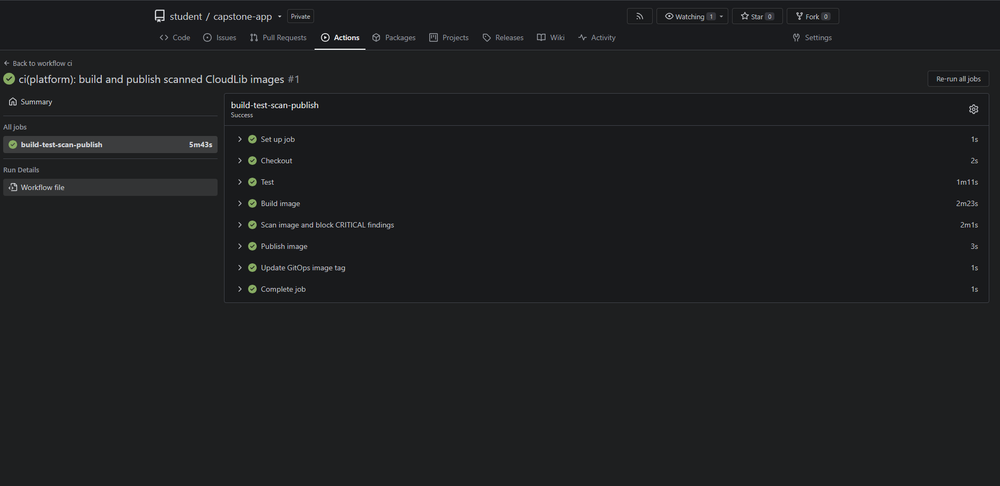
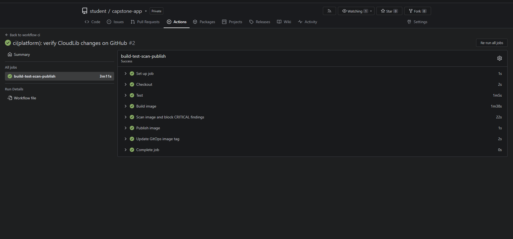

# Milestone 4 Evidence Report — CI/CD dan GitOps

- **Proyek** CloudLib · **Track** Campus Services · **Kelompok** 6 (Kelas B, UPN Veteran Jakarta)
- **Peran** C (Platform & Delivery) · **Tanggal uji** 13 November 2026 (WIB)
- **Status** Pipeline, keterlacakan image, dan rollback terverifikasi di lab lokal.

## 1. Ringkasan Eksekutif

Gitea Actions menjalankan tes, build, dan Trivy sebelum memublikasikan image bertag SHA dan memperbarui GitOps. Argo CD menyinkronkan perubahan ke k3d. Rollback via `git revert` mengembalikan versi stabil dalam **202,96 detik**.

## 2. Tabel Bukti Formal (Evidence Register)

| Evidence ID | Scope | Owner | Sumber / Versi | Timestamp | Metode | Observasi | Interpretasi | Limitasi | Keputusan yang Didukung |
| --- | --- | --- | --- | --- | --- | --- | --- | --- | --- |
| **EVD-M4-C-01** | Gitea Actions dari tes, build, scan, publish, sampai update GitOps dan sinkronisasi Argo CD. | C, Platform & Delivery. Gate Trivy merupakan bagian kerja bersama C dan D. | Aplikasi `26c77567319e657cb0b8e42402ce04a4012c5c84`, GitOps `c43e2ac18e8bb0846a1476973d2e921870abb9a1`, image `registry:5000/student/capstone-app` dengan tag SHA aplikasi dan digest `sha256:624c490540b9db87c870069ebe5a795dfc6974875c621819aab8c68ec6c2ba72`. | 13 November 2026, 10.04.03 WIB. | Periksa run CI, digest registry, revisi Argo CD, dan image yang berjalan di pod. | Run #1 lulus **12 tes Maven**. Trivy mencatat **36 HIGH dan 0 CRITICAL**. Pipeline memublikasikan image dan memperbarui tag di GitOps. Argo CD `Synced` dan `Healthy`. | Versi yang berjalan dapat ditelusuri dari SHA aplikasi ke digest image dan commit GitOps. | Run #1 memperlihatkan jalur sukses pada lab lokal. | Gunakan versi Run #1 sebagai baseline rollback. |
| **EVD-M4-C-02** | Jalur gagal pada langkah scan sebelum publish dan update GitOps. | C, Platform & Delivery. | Workflow `26c77567319e657cb0b8e42402ce04a4012c5c84`, Trivy `0.76.0`, fixture `alpine:3.10.0`. | 13 November 2026, 10.23.45 WIB. | Jalankan blok shell scan dari workflow pada runner lokal dengan penanda untuk tahap publish dan update GitOps. | Trivy menemukan **3 CRITICAL** dan keluar dengan kode `1`. Kedua penanda tidak tercapai. | Langkah scan gagal saat menemukan `CRITICAL`. | Uji fixture menjalankan blok scan secara terisolasi. Bukti run negatif langsung di UI Gitea belum ada. | Gate `CRITICAL` dipakai untuk memblokir promosi image. |
| **EVD-M4-C-03** | Satu rollback versi aplikasi pada lab lokal. | C, Platform & Delivery. | Kandidat `fa5859b6b0b71dd7812bc04d0331fe72f9646545` dengan digest `sha256:7d8639e7d46d0c11f6d76b444469ca94aa21868086629a091eccf3a7b2d74ca6`. Revisi promosi GitOps `99ad4b66c676fd45f7775ad27a827df3895e43d3`, commit revert `01c86d9dd9b145fda65e51b2a403fe41123b3e17`, dan versi stabil `26c7756`. | 13 November 2026, 10.46.22,460 sampai 10.49.45,425 WIB. | Verifikasi kandidat Run #2 sudah sehat, revert commit promosi GitOps, lalu pantau auto-sync Argo CD, readiness Ingress, dan digest pod. | Versi stabil terverifikasi kembali dalam **202,96 detik**. Argo CD `Synced` dan `Healthy` pada commit revert. Seluruh 56 probe selama pemantauan mengembalikan HTTP 200. | Git revert mengembalikan versi stabil dengan riwayat promosi dan rollback yang bisa ditelusuri. | Satu uji dengan skema database yang sama. Durasi mencakup percobaan push yang gagal autentikasi dan push ulang. | Rollback QS07 lulus pada uji ini terhadap target **≤10 menit**. |
| **EVD-M4-C-04** | Migrasi nama aplikasi | C, Platform & Delivery. | Aplikasi `c6dbe7a1afa1a805c685a588ff18fc0538d32fc5`, GitOps `fa582850408134ec2efa62dbd73ddc934a62d5f1`, digest `sha256:67857ee7433ac85bee2d306349944622ab833abde39ab5e68f6be78649ca0470`. | 13 November 2026, 14:15 WIB, cek ulang. | Verifikasi Run #3, revisi Argo CD, digest pod, readiness, dan kueri Prometheus. | Run #3 sukses dengan 12 tes lulus, 36 HIGH, dan 0 CRITICAL. Argo CD `Synced` dan `Healthy`. Readiness HTTP 200 dengan PostgreSQL `UP`. | Repo, image, dan resource Kubernetes memakai `cloudlib-app`. | Verifikasi mencakup deploy dan scrape setelah migrasi. QS05 dan rollback tercatat pada konfigurasi awal. | Pakai nama `cloudlib-app` untuk deploy lab berikutnya. |

## 3. Screenshot dan Artefak Pengujian

**Gambar 1. Gitea Actions Run #1** menunjukkan pipeline deploy awal berhasil dalam 5 menit 43 detik.

**Gambar 2. Gitea Actions Run #2** menunjukkan promosi kandidat sebelum rollback berhasil dalam 3 menit 11 detik.

[Laporan Trivy Run #1](M4-Trivy-Run-01.txt) memuat temuan dan identitas image untuk D. [Arsip bukti M4](M4-Bukti-Mentah.zip) memuat log Run #1, output uji gate, serta data dan probe rollback.

## 4. Migrasi Nama CloudLib App

Run #1, Run #2, dan uji rollback berlangsung saat repo dan image bernama `capstone-app`. [Run #3 di Gitea lokal](http://localhost:3001/student/cloudlib-app/actions/runs/3) memublikasikan image bertag SHA ke `registry:5000/student/cloudlib-app`. Revisi GitOps `3ce9c42` menyesuaikan Deployment, Service, Ingress, ConfigMap, dan referensi Secret. Argo CD menyinkronkan Application `cloudlib-app` pada revisi promosi `fa58285`. Riwayat Actions tetap tersedia di repo Gitea yang sama.

## 5. Handoff Deploy

Push commit aplikasi yang sudah direview ke `main` di [Gitea `student/cloudlib-app`](http://localhost:3001/student/cloudlib-app). Setelah pipeline lulus, cek bahwa `student/capstone-gitops` menunjuk ke tag SHA yang sesuai, Application `cloudlib-app` di Argo CD `Synced` dan `Healthy`, lalu buka [readiness CloudLib di lab lokal](http://cloudlib.localhost:8088/q/health/ready). Laporan Trivy Run #1 dapat diteruskan ke D dengan identitas image yang tercantum pada laporan.
