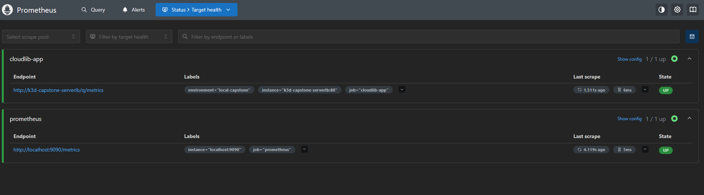

# Milestone 5 Evidence Report — Scrape Metrik CloudLib

- **Proyek** CloudLib · **Track** Campus Services · **Kelompok** 6 (Kelas B, UPN Veteran Jakarta)
- **Peran** C (Platform & Delivery) · **Tanggal uji** 13 November 2026 (WIB)
- **Status** Prometheus berhasil mengambil metrik CloudLib lewat Traefik.

## 1. Ringkasan Eksekutif

Prometheus mengambil metrik Micrometer dari `/q/metrics` melalui Traefik. Setelah migrasi nama, target `cloudlib-app` berstatus **UP** dan kueri `up{job="cloudlib-app"}` menghasilkan **1**. Hasil ini menjadi input pengukuran D.

## 2. Tabel Bukti Formal (Evidence Register)

| Evidence ID | Scope | Owner | Sumber / Versi | Timestamp | Metode | Observasi | Interpretasi | Limitasi | Keputusan yang Didukung |
| --- | --- | --- | --- | --- | --- | --- | --- | --- | --- |
| **EVD-M5-C-01** | Dukungan C untuk ekspos dan verifikasi scrape metrik CloudLib di lab lokal. | C (Platform & Delivery). | Image aplikasi registry:5000/student/capstone-app:26c77567319e657cb0b8e42402ce04a4012c5c84, image ID registry:5000/student/capstone-app@sha256:624c490540b9db87c870069ebe5a795dfc6974875c621819aab8c68ec6c2ba72, GitOps ee8edb279e5e17b1c19d940f70aec9f04b9ad323, Prometheus 3.15.1. | 2026-11-13T11:12:56.2500129+07:00 (WIB). | Validasi konfigurasi dengan promtool, ambil /q/metrics melalui Traefik, lalu periksa API targets dan jalankan kueri Prometheus. | Endpoint /q/metrics HTTP 200. Target capstone-app UP tanpa lastError. Kueri up menghasilkan 1, process_uptime_seconds menghasilkan 1411.753, dan http_server_bytes_written_count menghasilkan 451 pada sampel ini. | Prometheus pada jaringan Docker mengambil metrik Micrometer CloudLib lewat rute khusus /q/metrics yang dikelola Argo CD. | Satu target statis memakai nama load balancer cluster capstone dan satu replika. Kueri http_server_requests_seconds_count mengembalikan 0 seri pada pemeriksaan ini. Dashboard, metrik latensi p95 dan 5xx, QS04, dan QS08 masih perlu divalidasi oleh pemiliknya. | Gunakan target `cloudlib-app` untuk pengukuran berikutnya dan serahkan sampel metrik kepada D. |
| **EVD-M5-C-02** | Scrape setelah migrasi nama | C, Platform & Delivery. | Aplikasi `c6dbe7a`, GitOps `fa58285`. | 13 November 2026, sekitar 14:15 WIB, cek ulang. | Periksa Target Health dan jalankan kueri `up{job="cloudlib-app"}`. | Target `UP` dan kueri bernilai `1`. | Scrape berjalan setelah migrasi. | Pengamatan sesaat. | Gunakan label job `cloudlib-app` untuk pengukuran D. |

## 3. Screenshot dan Artefak Pengujian

**Gambar 1. Prometheus Targets setelah migrasi** menunjukkan target `cloudlib-app` berstatus **UP** pada `/q/metrics`.

[Arsip bukti M5](M5-Bukti-Mentah.zip) memuat output API, kueri, dan cuplikan metrik dari pengujian awal dengan job `capstone-app`. Handoff ke D mencakup target scrape `k3d-capstone-serverlb:80` dengan path `/q/metrics`, [Prometheus Targets di lab](http://localhost:9090/targets), dan label job `cloudlib-app`. Lihat [catatan migrasi M4](../M4/M4-Evidence-CI-CD-GitOps.md#4-migrasi-nama-cloudlib-app) untuk revisi deploy.
