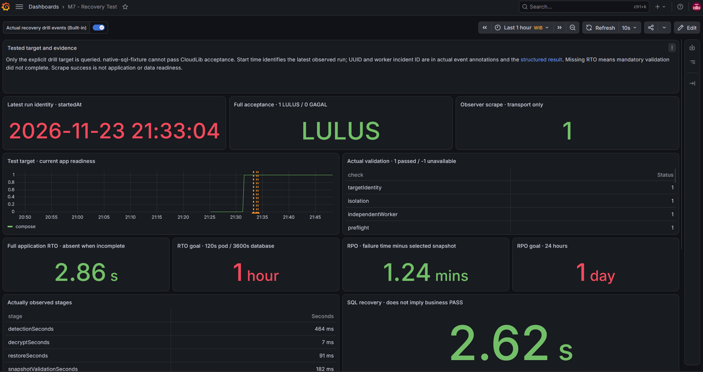
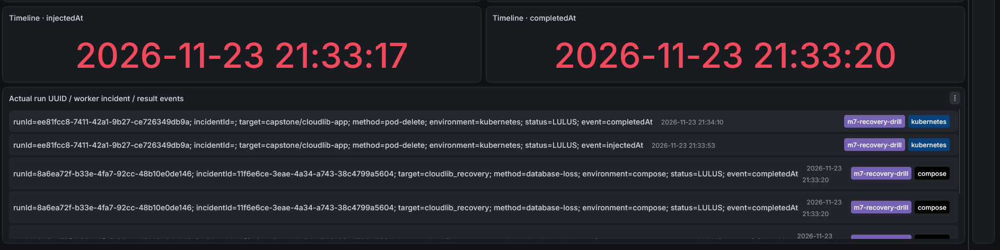

# M7 — Reliability & Recovery: bukti dan panduan demo

Status: **siap untuk demo lokal QS05/QS06**. Latihan aktual dilakukan pada 23 November 2026, bukan hanya fixture SQL. Backup pada fase ini tetap lokal dan terenkripsi di `app-repo/backups/`; Google Drive ditunda sesuai scope yang disetujui.

## Hasil yang telah dibuktikan

| Pemeriksaan | Hasil aktual |
| --- | --- |
| Gitea CI run 7 | Test, build, scan CRITICAL, publish, dan promosi GitOps berhasil. |
| Baseline aplikasi | Commit `475f9733a005214ed6e0cef2a3feb609bdf396f2`; tag dan digest dipromosikan bersama. |
| Manifest image | `sha256:45c043891b34312829cb749ea8e6fafa30535e4b375757b774eafd55ce85ece9`. |
| OIDC/role/tenant | Login PKCE nyata petugas, mahasiswa, admin berhasil; API anonim ditolak dan akses lintas tenant ditolak, pada lab dan recovery. |
| QS05: penggantian pod | **LULUS, 17,894 detik**, di bawah target 120 detik. Pod UID berubah; transaksi yang dibaca petugas tetap sama. |
| QS06: kehilangan database | **LULUS, RTO 2,860 detik**, di bawah target 1 jam. PostgreSQL tetap hidup; database `cloudlib_recovery` benar-benar hilang dan aplikasi sempat HTTP 500. |
| RPO QS06 | **74,263 detik** sejak titik snapshot, di bawah target 24 jam. A pulih, B setelah snapshot memang hilang. |
| Validasi QS06 | Delapan tabel, tujuh sequence, schema, Flyway, data per tenant, reservasi, kunjungan, pengembalian A dan kondisi eksemplar lolos. |
| Pemicu worker | `event` dari log PostgreSQL; bukan perintah restore dari skrip penguji. Rekonsiliasi tetap tersedia. |
| Backup Task Scheduler | Eksekusi melalui Task Scheduler pukul **21.33.48 WIB**, `LastTaskResult=0`, snapshot baru terverifikasi. Ini eksekusi manual task terdaftar, bukan klaim pemicu alami pukul 20.00 berhasil. |
| Monitoring | Observer dan job `cloudlib-recovery-drill` dapat dijangkau Prometheus; dashboard 15 panel, RTO/RPO serta anotasi run nyata tersedia. |
| Data utama | Inventori agregat sebelum dan setelah deployment/pengujian **identik**. Tidak ada transaksi bisnis uji yang ditulis ke database utama. |
| Regresi host/injector/HTTP | **8/8 lulus, 0 skip**, memakai PostgreSQL 17 dan age nyata pada fixture tersendiri. |

Run QS06: `8a6ea72f-b33e-4fa7-92cc-48b10e0de146`, insiden worker `11f6e6ce-3eae-4a34-a743-38c4799a5604`, injeksi pukul 21.33.17,523 WIB. Run QS05: `ee81fcc8-7411-42a1-9b27-ce726349db9a`, injeksi pukul 21.33.53,002 WIB. Angka merupakan satu pengamatan per skenario, bukan jaminan semua run akan sama cepat.

Rincian tahapan QS06: deteksi 0,464 detik, pemilihan backup 0,120 detik, dekripsi 0,007 detik, `pg_restore` 0,091 detik, validasi snapshot 0,182 detik, validasi aplikasi 0,244 detik. Durasi tahapan tidak mencakup seluruh overhead proses dan tidak harus menjumlah menjadi RTO.

## Perbaikan yang dilakukan

- HTTP operasional memakai `node:http.request` agar koneksi tetap ke IPv4 terverifikasi dan Host asli benar-benar dikirim. Regresi sebelumnya menghasilkan 404 walaupun aplikasi sehat; tes reproduksi kini lulus.
- Runtime Java memakai digest base image yang telah diperbarui. Run 5 sebelumnya dihentikan Trivy karena satu CRITICAL; gate tetap dipertahankan dan run 6/7 lulus.
- Pipeline GitOps mempromosikan digest registry setelah scan/push, sehingga versi yang dipakai QS05 dapat dicocokkan secara tetap.
- QS05 membaca transaksi tenant sendiri sebagai petugas. Akun mahasiswa uji baru belum memiliki transaksi di database utama; pengujian tidak perlu menambahkan transaksi ke sana.
- Task backup sekarang memuat private env-file. Sebelumnya task terdaftar tanpa `-EnvFile`, sehingga konfigurasi dengan referensi password gagal `MISSING_CREDENTIAL`.
- Backup utama berada di `backups/`; backup snapshot drill berada di `backups/recovery/`, dengan logical source berbeda. Backup harian tidak mengganti snapshot A/B yang dipakai worker.
- Dry-run menulis `<resultFile>.preflight.json`, sehingga hasil injeksi terakhir yang sedang dipantau tidak tertimpa hasil preflight.
- Tabel Grafana memakai format table agar seluruh check/tahapan dapat dibaca sekaligus; zona waktu dashboard WIB. Publikasi ulang anotasi run yang sama tidak menambahkan anotasi baru.

## Jalankan demo yang sudah disiapkan pada laptop ini

Jalankan dari PowerShell pada checkout aplikasi berikut. Perintah memakai konfigurasi privat laptop lab; untuk laptop anggota lain, ikuti [setup M7](../../../reliability/SETUP-M7.md). Saat penyerahan demo, checkpoint A/B telah disiapkan dan dry-run menghasilkan `PREFLIGHT_OK` tanpa injeksi. Setiap QS06 yang berhasil memakai checkpoint tersebut; siapkan checkpoint baru melalui bagian pengulangan sebelum menjalankan QS06 lagi.

```powershell
Set-Location F:\Cloud_Computing_Common_Capstone_Infrastructure_Package\source\templates\app-repo
$config = (Resolve-Path .\reliability\.runtime\drill\recovery-test.json).Path
$privateEnv = (Resolve-Path .\reliability\.runtime\.env).Path

# Pemeriksaan saja; tidak menghapus database.
.\scripts\recovery-test.ps1 -ConfigPath $config -EnvFile $privateEnv -DryRun

# Demo QS06: hanya cloudlib_recovery pada server terisolasi yang dipin.
.\scripts\recovery-test.ps1 -ConfigPath $config -EnvFile $privateEnv
```

Hasil wajib `status: LULUS` dan exit code 0. JSON hasil QS06 ada di `reliability/.runtime/drill/database-result.json`; `result.json` memuat injeksi terbaru dari QS05 atau QS06 untuk monitoring. Skrip tidak memulai worker, memanggil restore, membuat backup atau mengirim pemicu pemulihan buatan. Worker Compose harus sudah berjalan sebelum pengujian.

Buka [dashboard M7](http://localhost:3000/d/m7-recovery-test/m7-recovery-test) di samping terminal. [Target Prometheus](http://localhost:9090/targets) harus menampilkan `cloudlib-recovery-drill` sebagai UP. [Hasil terstruktur observer](http://localhost:19090/result) mengikuti hasil injeksi terakhir. Panel readiness mengamati target recovery; panel hasil dan durasi berubah setelah run selesai. `up=1` hanya membuktikan scrape, bukan keberhasilan restore.

Untuk QS05, gunakan entrypoint yang sama dengan konfigurasi pod:

```powershell
$podConfig = (Resolve-Path .\reliability\.runtime\drill\pod-test.json).Path
.\scripts\recovery-test.ps1 -ConfigPath $podConfig -EnvFile $privateEnv -DryRun
.\scripts\recovery-test.ps1 -ConfigPath $podConfig -EnvFile $privateEnv
```

QS05 menghapus satu pod yang UID, deployment, namespace, context dan image-nya telah diperiksa. Database utama tidak dihapus. Hasilnya terpisah pada `pod-result.json`; dashboard mengikuti injeksi terbaru. Pada QS05, RTO dibandingkan dengan 120 detik, sedangkan RPO dan tahapan restore database tidak berlaku. Jenis pengujian terlihat di panel identitas run.

## Mengulang QS06 setelah LULUS

Run yang berhasil mengembalikan pinjaman A dan menghilangkan B sesuai snapshot, sehingga checkpoint yang sama tidak dapat dipakai lagi. Setelah memastikan hasil sebelumnya LULUS dan tidak ada pengujian aktif, arsipkan checkpoint yang telah dipakai, lalu buat A/snapshot/B baru:

```powershell
$last = Get-Content .\reliability\.runtime\drill\database-result.json -Raw | ConvertFrom-Json
if ($last.status -ne 'LULUS') { throw 'Periksa kegagalan sebelumnya sebelum menyiapkan run baru.' }
Move-Item -LiteralPath .\reliability\.runtime\drill\checkpoint.json -Destination ('.\reliability\.runtime\drill\checkpoint-' + $last.testRunId + '.used.json')
node --env-file=reliability/.runtime/.env reliability/recovery-checkpoint.mjs prepare-a --config $config
if ($LASTEXITCODE -ne 0) { throw 'Persiapan A gagal; periksa transaksi yang mungkin sudah commit.' }
node --env-file=reliability/.runtime/.env reliability/backup.mjs create --config (Resolve-Path .\reliability\.runtime\drill\producer.json).Path
if ($LASTEXITCODE -ne 0) { throw 'Backup gagal; jangan lanjutkan seal-b.' }
node --env-file=reliability/.runtime/.env reliability/recovery-checkpoint.mjs seal-b --config $config
if ($LASTEXITCODE -ne 0) { throw 'Seal B gagal; jangan jalankan injeksi.' }
.\scripts\recovery-test.ps1 -ConfigPath $config -EnvFile $privateEnv -DryRun
```

Snapshot lebih tua dari 24 jam ditolak. Jangan menjalankan pengujian bisnis lain, membuat backup drill baru, atau mengganti image di tengah run A/B. Backup harian utama menggunakan folder terpisah dan tidak mengubah snapshot drill.

## Monitoring dan anotasi setelah run baru

Observer sudah berjalan pada loopback 19090. Jika setelah menutup terminal/reboot proses tersebut berhenti, jalankan kembali pada terminal terpisah dan biarkan terminalnya terbuka:

```powershell
node reliability/recovery-observer.mjs --result (Resolve-Path .\reliability\.runtime\drill\result.json).Path --port 19090
```

Prometheus sudah memuat job tersebut. Konfigurasi telah diperiksa `promtool` dan direload melalui SIGHUP tanpa restart host. Docker Prometheus terbukti dapat mencapai observer loopback Windows melalui `host.docker.internal`; tidak diperlukan binding `0.0.0.0`.

Untuk memperbarui anotasi setelah run berikutnya, muat kredensial Grafana yang telah ada pada proses PowerShell tanpa mencetak nilainya:

```powershell
. ..\..\scripts\_common.ps1
$env:CLOUDLIB_GRAFANA_USER = $env:GRAFANA_ADMIN_USER
$env:CLOUDLIB_GRAFANA_PASSWORD = $env:GRAFANA_ADMIN_PASSWORD
.\scripts\Publish-RecoveryDashboard.ps1 -ResultPath .\reliability\.runtime\drill\result.json
```

`result.json` selalu menunjuk injeksi terbaru dari kedua skenario. Untuk memublikasikan hasil QS05 tertentu, gunakan `pod-result.json`; untuk QS06 tertentu, gunakan `database-result.json`. Publisher menolak tabrakan dengan dashboard yang bukan miliknya. Metrik tidak memakai UUID sebagai label time-series; identitas lengkap ada pada JSON dan anotasi.

## Bukti





[M7-Bukti-Mentah.zip](M7-Bukti-Mentah.zip) berisi hasil QS05/QS06, status worker, ringkasan CI/scheduler/monitoring, pemeriksaan integritas utama, serta log regresi yang telah disanitasi. Arsip ini tidak berisi dump database, checkpoint privat, kunci age, password, token, maupun file `.env`. Arsip backup `.age` dan metadata runtime tetap diabaikan Git.

## Batas pengujian

- Backup satu drive tidak melindungi kehilangan laptop/drive. Server/volume PostgreSQL dan data Keycloak bukan sasaran recovery otomatis ini.
- Backup logis memulihkan semua tenant ke satu titik snapshot. Transaksi sesudah snapshot dapat hilang; B memang menunjukkan kondisi tersebut.
- Pemicu alami pukul 20.00 WIB pada 23 November sempat gagal saat runtime bermasalah. Eksekusi task terdaftar setelah perbaikan telah berhasil; keberhasilan alami hari berikutnya dan catch-up setelah laptop benar-benar offline belum diamati. Jadwal 20.00 WIB, `StartWhenAvailable`, dan kebijakan retensi tujuh hari telah dikonfigurasi; ini bukan tujuh hari histori operasional.
- Worker berhenti mendadak atau backup terhenti dapat memerlukan inspeksi operator sesuai prosedur existing. Jangan menghapus lock/state atau kandidat database untuk memaksa hasil LULUS.
- Artefak demo dan perbaikan host berada di checkout lokal. Image Java yang didemokan mengikuti commit/digest CI pada tabel, sedangkan perbaikan skrip host sesudahnya tidak mengubah image Java.
