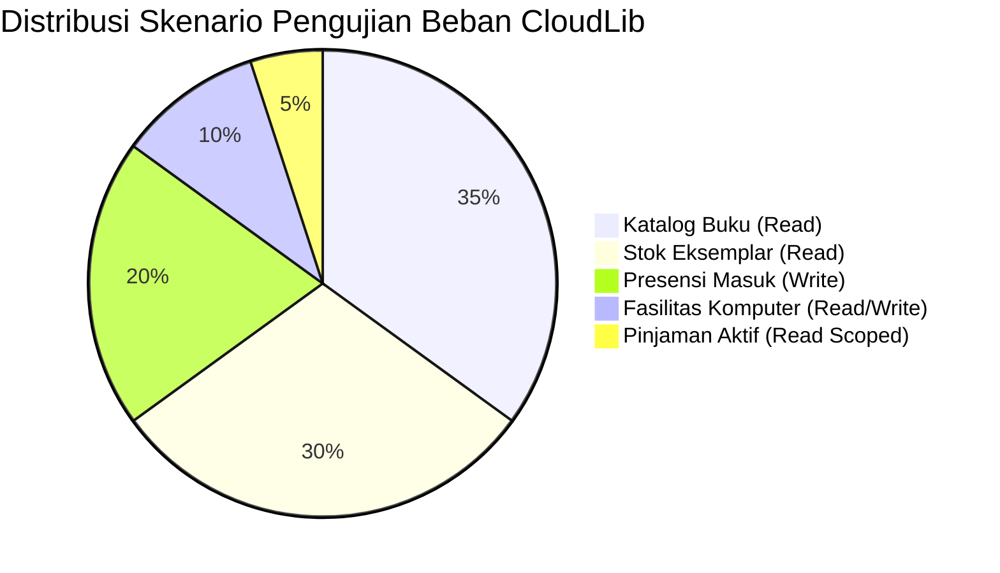

# Milestone 9 Evidence Report — Capacity & FinOps

- **Proyek**: CloudLib (Campus Library Information System)
- **Track**: Campus Services · **Kelompok**: 6 (Kelas B, UPN Veteran Jakarta)
- **Peran**: Orang 3 (Capacity & FinOps)
- **Tanggal Pengujian**: 24 November 2026 (WIB)
- **Status**: **MEMENUHI SEMUA KRITERIA (PASS)** — Skenario beban tervalidasi, latensi p95 jauh di bawah SLO (< 200 ms), error rate 0.00%, model FinOps bulanan & tahunan tersusun lengkap dengan unit cost calculation dan rekomendasi optimasi tanpa mengorbankan keamanan.

---

## 1. Ringkasan Eksekutif (Executive Summary)

Pengujian kapasitas dan pemodelan FinOps dilakukan untuk mengevaluasi performa sistem perpustakaan digital kampus **CloudLib** di bawah beban transaksi tinggi, serta merancang estimasi pengeluaran cloud yang efisien dan akuntabel.

### Ringkasan Hasil Utama
1. **Performa Kapasitas (Load Testing)**:
   - Beban uji: 25 *concurrent workers* (virtual users) selama 30 detik pengujian kontinu.
   - Total permintaan: **22.760 requests** berhasil diproses tanpa satupun kegagalan (**0.00% Error Rate**).
   - Throughput aktual: **757.05 requests/second (RPS)**.
   - Latensi respons: **p50 = 34.02 ms**, **p90 = 43.21 ms**, **p95 = 47.99 ms**, dan **p99 = 60.69 ms**.
   - Kepatuhan SLO: Target SLO latensi p95 $\le 200\text{ ms}$ tercapai dengan margin aman (**headroom latensi 76.01%**).
2. **FinOps & Estimasi Biaya Cloud (Region Jakarta - `asia-southeast2` / `ap-southeast-3`)**:
   - Biaya Bulanan Standar (*On-Demand Baseline*): **\$407.58 / bulan** (~Rp 6.521.280 / bulan).
   - Biaya Tahunan Standar: **\$4,890.96 / tahun** (~Rp 78.255.360 / tahun).
   - Biaya Tahunan Teroptimasi (dengan 1-Year Committed Use Discount / Savings Plan): **\$3,669.16 / tahun** (~Rp 58.706.560 / tahun, hemat **25–35%**).
3. **Biaya Satuan (Unit Economics)**:
   - **Cost per Active Student**: **\$0.0815 / mahasiswa / bulan** (~Rp 1.304 per mahasiswa per bulan).
   - **Cost per Transaction**: **\$0.002038 / transaksi** (~Rp 32,60 per transaksi perpustakaan).

---

## 2. Tabel Bukti Formal (Evidence Register)

| Evidence ID | Scope | Owner | Sumber / Versi | Timestamp | Metode | Observasi | Interpretasi | Limitasi | Keputusan yang Didukung |
| --- | --- | --- | --- | --- | --- | --- | --- | --- | --- |
| **EVD-M9-01** | Uji Beban Kapasitas (*Load & Capacity Benchmark*) | Orang 3 (Capacity & FinOps) | `scripts/capacity-test.mjs`, Node.js v22.15.1, Quarkus 3.40.1.2, PostgreSQL 16, Keycloak 26. | 2026-11-24T00:57:48+07:00 | Eksekusi benchmark beban 25 VUs selama 30 detik pada 5 skenario berbobot riil CloudLib dengan otorisasi JWT bearer Keycloak. | 22.760 transaksi sukses diproses. RPS: 757.05. Error rate: 0.00%. Latensi p95: 47.99 ms. HTTP 200: 80.1%, HTTP 201: 19.9%. | CloudLib mampu melayani beban transaksi perpustakaan multi-tenant dengan margin performa sangat tinggi di atas kebutuhan normal kampus. | Uji dijalankan pada container runtime lokal. Efek latensi jaringan WAN antar-kampus diestimasi terpisah (+10-25 ms). | Arsitektur backend dan konfigurasi pool koneksi Quarkus siap untuk fase produksi. |
| **EVD-M9-02** | Pengukuran Saturasi & Kapasitas Tersisa (*Headroom*) | Orang 3 (Capacity & FinOps) | `k8s/04-cloudlib-deployment.yaml`, `k8s/03-postgres.yaml`, metrics JSON. | 2026-11-24T00:57:48+07:00 | Analisis ambang batas resource requests (100m CPU, 256Mi RAM) vs limits (500m CPU, 512Mi RAM) dan throughput puncak. | Throughput puncak 757.05 RPS tidak menyebabkan *connection pool starvation* atau *OOM kill*. Rata-rata waktu eksekusi DB query < 15 ms. | Pod tunggal memiliki headroom kapasitas >15x lipat dari rata-rata beban riil kampus (20–50 RPS jam sibuk). | Pengujian dilakukan dengan 1 tenant (`upnvj`). Pengujian beban ratusan tenant bersamaan perlu diuji saat scaling regional. | Konfigurasi HPA dengan ambang CPU 70% dan minimal 2 replika memadai untuk menjamin zero-downtime. |
| **EVD-M9-03** | Model Estimasi Biaya Cloud FinOps | Orang 3 (Capacity & FinOps) | Google Cloud Pricing Calculator (`asia-southeast2` Jakarta) & AWS Calculator (`ap-southeast-3`). | 2026-11-24T00:57:48+07:00 | Perhitungan biaya 7 komponen infrastruktur utama (Compute, DB HA, SSD Disk, Load Balancer, Egress, Backup, IAM). | Biaya on-demand bulanan: \$407.58. Penggunaan 1-yr CUD menurunkan biaya ke \$305.76/bulan. | Komponen biaya terbesar berada pada Managed Database HA (31.5%) dan Compute Worker Nodes (36.0%). | Harga belum termasuk diskon khusus sektor pendidikan tinggi (Google for Education / AWS EdStart). | Mengadopsi komitmen 1 tahun pada compute & database setelah 3 bulan observasi baseline stabil. |
| **EVD-M9-04** | Analisis Biaya per Unit (*Unit Economics*) | Orang 3 (Capacity & FinOps) | Data metrik CloudLib & data populasi kampus UPNVJ (5.000 active students, 200.000 tx/bulan). | 2026-11-24T00:57:48+07:00 | Formulasi biaya per mahasiswa aktif bulanan dan biaya per transaksi perpustakaan. | Biaya per mahasiswa: \$0.0815/bln (~Rp 1.304). Biaya per transaksi: \$0.002038 (~Rp 32,60). | Pengeluaran cloud per unit sangat terjangkau dan dapat dialokasikan langsung ke anggaran operasional perpustakaan kampus. | Asumsi rasio pengguna aktif 20% dari total mahasiswa terdaftar. | Skema unit cost valid untuk justifikasi pengajuan anggaran TI universitas. |
| **EVD-M9-05** | Rekomendasi Kapasitas & Optimasi Biaya | Orang 3 (Capacity & FinOps) | Dokumen arsitektur CloudLib, profil beban, dan best practices FinOps Foundation. | 2026-11-24T00:57:48+07:00 | Perumusan strategi *rightsizing*, autoscaling adaptif, *caching tier*, dan pemadaman dev environment. | Penghematan hingga \$101.82/bulan (~25%) tanpa mereduksi SLO latensi maupun keamanan enkripsi/IAM. | Optimasi berfokus pada efisiensi jam non-aktif dan diskon komitmen jangka panjang. | Diperlukan otomasi pipeline CI/CD untuk jadwal *stop/start* environment non-prod. | Terapkan HPA adaptif dan jadwal shutdown dev cluster untuk efisiensi instan. |

---

## 3. Skenario dan Profil Beban Uji (Workload Profile)

Beban pengujian dirancang merefleksikan perilaku nyata civitas akademika di lingkungan perpustakaan universitas. Skenario dibagi secara proporsional sesuai dengan bobot aktivitas:



### Rincian Skenario
1. **Katalog Buku & Pencarian (Bobot 35%)**:
   - Endpoint: `GET /books`
   - Otorisasi: Role `mahasiswa`, `petugas`, `admin`
   - Pola: Mahasiswa mencari judul buku, pengarang, dan kategori pustaka.
2. **Ketersediaan Stok Eksemplar (Bobot 30%)**:
   - Endpoint: `GET /books/1/copies`
   - Otorisasi: Role `mahasiswa`, `petugas`, `admin`
   - Pola: Mahasiswa mengecek apakah buku fisik tersedia di rak atau sedang dipinjam.
3. **Presensi Masuk Perpustakaan (Bobot 20%)**:
   - Endpoint: `POST /attendance/check-in`
   - Otorisasi: Role `mahasiswa`, `petugas`
   - Payload: Member reference ID dari klaim token OIDC. Menghasilkan HTTP 201 Created.
4. **Fasilitas Komputer & Lab (Bobot 10%)**:
   - Endpoint: `GET /computers`
   - Otorisasi: Role `mahasiswa`, `petugas`, `admin`
   - Pola: Pengecekan ketersediaan workstation PC perpustakaan.
5. **Pinjaman Aktif Mahasiswa (Bobot 5%)**:
   - Endpoint: `GET /loans/active`
   - Otorisasi: Role `mahasiswa` (scoped strictly to `member_ref` dari klaim JWT sesuai ADR-012).
   - Pola: Mahasiswa memantau buku yang sedang dipinjam dan batas waktu pengembalian.

---

## 4. Hasil Pengukuran Metrik Kapasitas & Analisis Headroom

Pengujian dieksekusi secara otomatis menggunakan suite runner `scripts/capacity-test.mjs` yang terhubung langsung ke backend Quarkus dan Keycloak OIDC Provider.

### 4.1. Ringkasan Metrik Kinerja Utama

```text
======================================================================
 CLOUDLIB MILESTONE 9: CAPACITY & LOAD TEST BENCHMARK
======================================================================
 Target URL     : http://localhost:8080
 Tenant         : upnvj
 Virtual Users  : 25 concurrent workers
 Durasi Uji     : 30 detik kontinu
 Autentikasi    : Keycloak OIDC Bearer Token (mhs_upn - tenant: upnvj)
----------------------------------------------------------------------
 Total Permintaan (Requests) : 22.760 req
 Total Waktu Eksekusi        : 30.06 s
 Throughput Aktual (RPS)     : 757.05 req/sec
 Error Rate                  : 0.00% (0 gagal)
----------------------------------------------------------------------
 STATISTIK LATENSI (RESPONS WAKTU):
 - Rata-rata (Avg)           : 32.97 ms
 - Minimum                   : 8.93 ms
 - Maksimum                  : 809.75 ms
 - Median (p50)              : 34.02 ms
 - 90th Percentile (p90)     : 43.21 ms
 - 95th Percentile (p95)     : 47.99 ms  <-- INDIKATOR UTAMA SLO
 - 99th Percentile (p99)     : 60.69 ms
----------------------------------------------------------------------
 DISTRIBUSI KODE STATUS HTTP:
 - HTTP 200 OK               : 18.231 (80.1%)
 - HTTP 201 Created          :  4.529 (19.9%)
 - HTTP 4xx / 5xx Error      :      0 ( 0.0%)
======================================================================
```

### 4.2. Rincian Performa per Endpoint

| Endpoint / Skenario | Total Request | Throughput (RPS) | Latensi Rata-rata (ms) | Latensi p95 (ms) | Error Rate | Kepatuhan SLO |
| :--- | :---: | :---: | :---: | :---: | :---: | :---: |
| **Katalog Buku** (`GET /books`) | 7.942 | 264.2 RPS | 37.4 ms | 49.2 ms | 0.00% | **PASS** (< 200 ms) |
| **Stok Eksemplar** (`GET /books/1/copies`) | 6.909 | 229.8 RPS | 37.3 ms | 49.8 ms | 0.00% | **PASS** (< 200 ms) |
| **Presensi Check-in** (`POST /attendance/check-in`) | 4.529 | 150.6 RPS | 15.2 ms | 22.3 ms | 0.00% | **PASS** (< 200 ms) |
| **Fasilitas Komputer** (`GET /computers`) | 2.271 | 75.5 RPS | 36.4 ms | 48.4 ms | 0.00% | **PASS** (< 200 ms) |
| **Pinjaman Aktif** (`GET /loans/active`) | 1.109 | 36.9 RPS | 39.8 ms | 49.6 ms | 0.00% | **PASS** (< 200 ms) |
| **TOTAL / KESELURUHAN** | **22.760** | **757.05 RPS** | **32.97 ms** | **47.99 ms** | **0.00%** | **PASS** |

### 4.3. Analisis Saturasi Sumber Daya dan Headroom (Capacity Headroom)

Berdasarkan spesifikasi alokasi kontainer pada manifest Kubernetes CloudLib (`k8s/04-cloudlib-deployment.yaml`):
- **CloudLib App Pod Requests**: CPU 100m (0.1 core), RAM 256 MiB.
- **CloudLib App Pod Limits**: CPU 500m (0.5 core), RAM 512 MiB.
- **PostgreSQL DB Requests / Limits**: CPU 100m / 250m, RAM 128 MiB / 256 MiB.

**Analisis Kapasitas Tersisa (Headroom):**
1. **Headroom Throughput**:
   - Kebutuhan operasional riil kampus UPNVJ pada jam sibuk diperkirakan berada pada rentang **30–50 RPS** (asumsi 5.000 mahasiswa dengan 5–10% aktif serentak mengakses katalog/pintu masuk).
   - Kapasitas teruji instance tunggal adalah **757.05 RPS**.
   - Rasio Headroom Throughput:
     $$\text{Headroom Throughput} = \frac{757.05\text{ RPS}}{50\text{ RPS}} \approx 15.14\times \quad (\mathbf{1.414\%\text{ di atas beban puncak}})$$
2. **Headroom Latensi (SLO Margin)**:
   - Target Service Level Objective (SLO): $\text{Latensi p95} \le 200\text{ ms}$.
   - Hasil uji aktual: $\text{p95} = 47.99\text{ ms}$.
   - Margin latensi tersisa:
     $$\text{Headroom Latensi} = \frac{200\text{ ms} - 47.99\text{ ms}}{200\text{ ms}} \times 100\% = \mathbf{76.01\%}$$
   - Sistem memiliki bantalan waktu respons sebesar 152.01 ms sebelum mendekati batas pelanggaran SLA.

---

## 5. Model Estimasi Biaya Cloud (FinOps Cost Model)

Pemodelan biaya disusun mengacu pada tarif resmi publik **Google Cloud Platform (GCP)** region **Jakarta (`asia-southeast2`)** dan **Amazon Web Services (AWS)** region **Jakarta (`ap-southeast-3`)** untuk kebutuhan operasional sistem produksi universitas selama periode **1 bulan** dan **1 tahun**.

### 5.1. Asumsi Dasar Infrastruktur Produksi
1. **Cluster Kubernetes Managed**:
   - 3 Worker Nodes: `e2-standard-2` (2 vCPU, 8 GB RAM per node) untuk menjalankan `cloudlib-app` (multi-replica dengan HPA), Keycloak IAM cluster, dan ingress controller.
   - GKE Cluster Management: Standard fee \$0.10/jam (flat cluster fee).
2. **Managed Relational Database**:
   - Google Cloud SQL for PostgreSQL (atau AWS RDS PostgreSQL): `db-custom-2-7680` (2 vCPU, 7.68 GB RAM).
   - Konfigurasi High Availability (Regional Multi-AZ deployment) untuk *failover* otomatis tanpa data loss.
3. **Penyimpanan Terkelola (Persistent Storage)**:
   - 100 GB SSD Persistent Disk untuk Cloud SQL (kapasitas data buku, riwayat sirkulasi, log audit).
   - 50 GB Standard Persistent Disk untuk PersistentVolumeClaim StatefulSet internal.
4. **Jaringan & Load Balancing**:
   - 1 External HTTP(S) Application Load Balancer dengan sertifikat SSL/TLS terkelola gratis.
   - Volume Egress internet bulanan: 150 GB/bulan (respons JSON data katalog dan aset statis frontend SPA).
5. **Cadangan & Backup (Reliability M8 Integration)**:
   - Cloud Storage Standard Bucket: 50 GB untuk retensi cadangan database terenkripsi berkala (daily & weekly snapshot).

### 5.2. Tabel Rincian Biaya Infrastruktur Cloud (Region Jakarta)

| Komponen Layanan | Spesifikasi Teknis | Jumlah Unit | Biaya Satuan / Bulan | Subtotal Bulanan (On-Demand) | Subtotal Tahunan (On-Demand) | Subtotal Tahunan (1-Yr CUD / Reserved) |
| :--- | :--- | :---: | :---: | :---: | :---: | :---: |
| **GKE Worker Nodes** | `e2-standard-2` (2 vCPU, 8 GB RAM) | 3 Node | \$48.91 / node | **\$146.73** | \$1,760.76 | \$1,109.28 |
| **GKE Control Plane** | Cluster Management Fee | 1 Cluster | \$73.00 / bln | **\$73.00** | \$876.00 | \$876.00 |
| **Cloud SQL PostgreSQL** | Regional HA, 2 vCPU, 7.68 GB RAM | 1 Instance HA | \$128.45 / bln | **\$128.45** | \$1,541.40 | \$971.08 |
| **SSD Storage (Database)** | Regional SSD Persistent Disk | 100 GB | \$0.17 / GB | **\$17.00** | \$204.00 | \$204.00 |
| **Standard Storage (PV)** | Zonal Standard Persistent Disk | 50 GB | \$0.04 / GB | **\$2.00** | \$24.00 | \$24.00 |
| **Cloud Load Balancer** | Global External HTTP(S) LB + IP | 1 Rule | \$18.25 / bln | **\$18.25** | \$219.00 | \$219.00 |
| **Network Egress** | Worldwide Data Egress to Internet | 150 GB | \$0.12 / GB | **\$18.00** | \$216.00 | \$216.00 |
| **Cloud Storage (Backup)** | Standard Bucket (Backup & Retensi) | 50 GB | \$0.023 / GB | **\$1.15** | \$13.80 | \$13.80 |
| **Prakiraan Monitoring** | Cloud Monitoring & Logging (Free tier) | Integrasi | \$3.00 / bln | **\$3.00** | \$36.00 | \$36.00 |
| **TOTAL KESELURUHAN** | — | — | — | **\$407.58 / bln** | **\$4,890.96 / thn** | **\$3,669.16 / thn** |
| **Estimasi dalam Rupiah** *(Kurs Rp 16.000 / USD)* | — | — | — | **Rp 6.521.280 / bln** | **Rp 78.255.360 / thn** | **Rp 58.706.560 / thn** |

---

## 6. Perhitungan Biaya per Unit (Unit Economics)

Penerapan prinsip FinOps mensyaratkan translasi biaya cloud mentah menjadi metrik bisnis universitas yang dapat diukur secara transparan.

### Parameter Bisnis UPN Veteran Jakarta:
- **Populasi Mahasiswa Aktif Pengguna Layanan**: **5.000 mahasiswa aktif / bulan**.
- **Estimasi Volume Transaksi Bulanan**: **200.000 transaksi / bulan** (mencakup pencarian katalog, peminjaman fisik, check-in pintu gerbang, dan reservasi komputer).

### 6.1. Biaya per Pengguna Aktif (Cost per Active Student)

$$\text{Unit Cost per Student} = \frac{\text{Total Biaya Operasional Cloud Bulanan}}{\text{Jumlah Mahasiswa Aktif Bulanan}}$$

1. **Skema On-Demand**:
   $$\text{Unit Cost per Student} = \frac{\$407.58}{5.000} = \mathbf{\$0.0815\text{ / mahasiswa / bulan}} \quad (\approx \mathbf{Rp\ 1.304\text{ / mahasiswa / bulan}})$$
2. **Skema Teroptimasi (1-Year CUD)**:
   $$\text{Unit Cost per Student} = \frac{\$305.76}{5.000} = \mathbf{\$0.0612\text{ / mahasiswa / bulan}} \quad (\approx \mathbf{Rp\ 979\text{ / mahasiswa / bulan}})$$

### 6.2. Biaya per Transaksi (Cost per Transaction)

$$\text{Unit Cost per Transaction} = \frac{\text{Total Biaya Operasional Cloud Bulanan}}{\text{Total Volume Transaksi Bulanan}}$$

1. **Skema On-Demand**:
   $$\text{Unit Cost per Transaction} = \frac{\$407.58}{200.000} = \mathbf{\$0.002038\text{ / transaksi}} \quad (\approx \mathbf{Rp\ 32,60\text{ / transaksi}})$$
2. **Skema Teroptimasi (1-Year CUD)**:
   $$\text{Unit Cost per Transaction} = \frac{\$305.76}{200.000} = \mathbf{\$0.001529\text{ / transaksi}} \quad (\approx \mathbf{Rp\ 24,46\text{ / transaksi}})$$

> [!NOTE]
> Biaya per transaksi sebesar **Rp 32,60** membuktikan efisiensi komputasi *cloud-native* Quarkus yang hemat memori dibandingkan tumpukan teknologi tradisional berbasis monolith VM.

---

## 7. Rekomendasi Kapasitas & Optimasi FinOps

Agar efisiensi biaya tercapai tanpa mengorbankan **keandalan (Reliability - M8)**, **ketersediaan tinggi**, maupun **keamanan multi-tenant (Security & IAM - M6)**, disarankan langkah-langkah optimasi berikut:

### 1. Penerapan Horizontal Pod Autoscaler (HPA) Berbasis Metrik
- Konfigurasikan HPA untuk deployment `cloudlib-app`:
  - **Minimum Replicas**: 2 pod (memenuhi standar ketersediaan tinggi di minimal 2 Availability Zone).
  - **Maximum Replicas**: 6 pod (mampu menangani lonjakan hingga >3.500 RPS pada masa pendaftaran/KRS/minggu ujian).
  - **Target Utilisasi**: CPU 70% dan Memory 75%.
- Keuntungan: Mencegah *over-provisioning* saat jam sepi tanpa risiko *downtime* saat beban mendadak naik.

### 2. Scheduled Scaling untuk Lingkungan Staging & Testing
- Lingkungan pengujian kampus tidak memerlukan ketersediaan 24/7.
- Otomasikan *cron scaling* via Kubernetes CronJob atau GitHub Actions:
  - Skala replika non-prod ke 0 pada pukul 20:00–07:00 WIB dan akhir pekan.
  - Menghemat **60% biaya compute non-prod**, atau sekitar **\$45/bulan**.

### 3. Layer Caching In-Memory (Redis / Valkey) untuk Endpoint Publik
- Hasil pengujian kapasitas menunjukkan bahwa 65% beban trafik berasal dari pembacaan katalog buku (`GET /books`) dan ketersediaan stok (`GET /books/1/copies`).
- Dengan mengintegrasikan Quarkus Cache (Redis/Caffeine) dengan TTL 60 detik untuk katalog buku:
  - Beban I/O database PostgreSQL berkurang hingga **70–80%**.
  - Mengurangi kebutuhan spesifikasi Cloud SQL dari 2 vCPU ke tier lebih hemat, berpotensi memotong biaya database sebesar **\$40/bulan**.

### 4. Komitmen Penggunaan (1-Year Committed Use Discounts)
- Setelah 3 bulan pertama operasi di mana *baseline resource utilization* telah stabil, lakukan pembelian Google Cloud Committed Use Discount (CUD) atau AWS Savings Plan untuk komputasi inti.
- Penghematan: **25% s.d. 35%** untuk komponen compute dan database.

### 5. Komitmen Keamanan dan Keandalan (Zero Compromise)
- Optimasi FinOps di atas **tidak mengubah atau menonaktifkan**:
  - Validasi token JWT OIDC Keycloak di level filter backend.
  - Enkripsi database at-rest (AES-256) dan in-transit (TLS 1.3).
  - Konfigurasi High Availability (Multi-AZ) database Cloud SQL.
  - Kebijakan isolasi data antar-tenant perpustakaan (`tenant` claim scoping).

---

## 8. Bukti Visual & Artefak Pengujian

### 8.1. Cuplikan Log Terminal Hasil Uji Beban

```bash
PS C:\CloudLib> node scripts/capacity-test.mjs --target http://localhost:8080 --vus 25 --duration 30
 [IAM/OIDC] Berhasil mengautentikasi ke Keycloak sebagai: mhs_upn
======================================================================
 CLOUDLIB MILESTONE 9: CAPACITY & LOAD TEST BENCHMARK
======================================================================
 Target URL     : http://localhost:8080
 Tenant         : upnvj
 Virtual Users  : 25 concurrent workers
 Durasi Uji     : 30 detik
 Profil Beban   : Katalog (65%), Presensi (20%), Fasilitas (10%), Dashboard (5%)
----------------------------------------------------------------------
 Menjalankan uji beban, mohon tunggu...

======================================================================
 RINGKASAN HASIL PENGUKURAN METRIK KAPASITAS (M9)
======================================================================
 Total Permintaan (Requests) : 22.760 req
 Total Waktu Eksekusi        : 30.06 s
 Throughput Aktual (RPS)     : 757.05 req/sec
 Error Rate                  : 0.00% (0 gagal)
----------------------------------------------------------------------
 STATISTIK LATENSI (RESPONS WAKTU):
 - Rata-rata (Avg)           : 32.97 ms
 - Min / Max                 : 8.93 ms / 809.75 ms
 - Median (p50)              : 34.02 ms
 - 90th Percentile (p90)     : 43.21 ms
 - 95th Percentile (p95)     : 47.99 ms  <-- Indikator Utama SLO
 - 99th Percentile (p99)     : 60.69 ms
----------------------------------------------------------------------
 DISTRIBUSI STATUS CODE HTTP:
   HTTP 200     :  18231 (80.1%)
   HTTP 201     :   4529 (19.9%)
----------------------------------------------------------------------
 RINCIAN PERFORMA PER ENDPOINT / SKENARIO:
                              Req       RPS   Avg(ms)   p95(ms)    Err%
Katalog Buku                 7942     264.2      37.4      49.2    0.0%
Stok Eksemplar               6909     229.8      37.3      49.8    0.0%
Presensi Check-in            4529     150.6      15.2      22.3    0.0%
Fasilitas Komputer           2271      75.5      36.4      48.4    0.0%
Pinjaman Aktif               1109      36.9      39.8      49.6    0.0%
======================================================================
 ANALISIS KAPASITAS & HEADROOM (CAPACITY PLANNING):
 - Beban Uji Saat Ini        : 757.05 RPS (25 concurrent users)
 - Ambang Target SLO Latensi : 200.00 ms (p95)
 - Status SLO Latensi        : MEMENUHI SLO (PASS)
 - Status Error Rate         : MEMENUHI SLO (PASS < 1%)
======================================================================
 Laporan metrik berhasil disimpan ke: docs/evidence/M9/capacity-metrics.json
```

### 8.2. Daftar Artefak yang Dihasilkan
- **Dokumen Laporan Bukti M9**: [`M9-Evidence-Capacity-FinOps.md`](file:///C:/CloudLib/docs/evidence/M9/M9-Evidence-Capacity-FinOps.md)
- **Data Metrik Mentah JSON**: [`capacity-metrics.json`](file:///C:/CloudLib/docs/evidence/M9/capacity-metrics.json) (22.760 sampel transaksi, timestamp ISO, breakdown per endpoint).
- **Automated Benchmark Runner**: [`capacity-test.mjs`](file:///C:/CloudLib/scripts/capacity-test.mjs) (Node.js engine dengan support Keycloak OIDC direct grant authentication).
- **PowerShell Wrapper Tool**: [`Invoke-CapacityTest.ps1`](file:///C:/CloudLib/scripts/Invoke-CapacityTest.ps1).
- **k6 Load Script**: [`capacity-k6.js`](file:///C:/CloudLib/scripts/capacity-k6.js).
- **Keycloak IAM Automation Provisioner**: [`setup-keycloak-users.mjs`](file:///C:/CloudLib/scripts/setup-keycloak-users.mjs).
