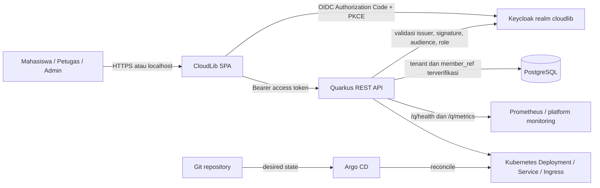

# Panduan Presentasi Teori dan Teknis CloudLib

Dokumen ini adalah panduan narasi dan demo untuk menjelaskan CloudLib dari
masalah bisnis, rancangan cloud-native, implementasi keamanan, sampai hasil
reliability dan capacity. Angka dan status di bawah mengikuti evidence yang
tersedia di repository; status cluster dapat berubah, jadi jalankan pemeriksaan
live sebelum presentasi.

## Panduan praktis: yang ditampilkan, diketik, dan dijelaskan

Bagian ini adalah naskah demo yang diikuti saat presentasi. Bagian-bagian
bernomor setelahnya menjadi catatan teori dan jawaban teknis jika dosen bertanya
lebih dalam.

### Sebelum mulai presentasi

Siapkan tiga jendela:

1. Browser pada `http://localhost:8080`.
2. PowerShell untuk aplikasi dan pemeriksaan endpoint.
3. PowerShell untuk Kubernetes/Argo CD.

Pastikan akun mahasiswa, petugas, dan admin sudah bisa login. Password hanya
diambil dari environment privat; jangan dimasukkan ke slide atau direkam.
Gunakan data demo yang sudah tersedia. Hindari membuat/menghapus data baru saat
presentasi jika alurnya belum dilatih.

Jalankan pemeriksaan ini di PowerShell. Jika aplikasi belum menyala, ikuti
bagian **Runbook startup lokal** di bawah untuk menyalakan layanan.

```powershell
Set-Location 'D:\Kuliah\Yanu\Semester 5\Cloud Computing\INFRASTRUCTURE'
docker info --format '{{.ServerVersion}}'
curl.exe -i http://localhost:8081/realms/cloudlib/.well-known/openid-configuration
curl.exe -i http://localhost:8080/q/health/ready
```

Jangan start Quarkus kedua jika readiness sudah HTTP 200.

### Naskah demo 12-15 menit

| Waktu | Yang ditampilkan | Yang dilakukan / diketik | Yang dijelaskan |
| --- | --- | --- | --- |
| 0:00-1:00 | Diagram GitDiagram lalu diagram alur runtime di bagian Arsitektur | Tidak perlu command | “Ini gambaran komponen repository; diagram runtime menjelaskan interaksi pengguna, Keycloak, API, database, dan platform.” |
| 1:00-3:00 | UI CloudLib di browser | Login mahasiswa, tunjukkan NIM/NPM, katalog, pinjaman/reservasi, dan check-in langsung jika data demo siap | “Mahasiswa memakai fitur sesuai identitasnya. Check-in saat ini memakai sesi login, bukan QR dinamis.” |
| 3:00-4:30 | UI petugas lalu admin | Logout/login dengan akun petugas; tunjukkan workflow yang tersedia. Lalu tunjukkan dashboard dengan akun admin. | “Role menentukan fitur. Aksi penting tetap diperiksa backend, bukan hanya tombol yang disembunyikan UI.” |
| 4:30-6:30 | Source OIDC, `TenantIdentity`, `BookResource` | Ketik pemeriksaan API anonim dari Terminal 1; buka file kode yang disebut di bawah. | “Keycloak menerbitkan identitas. API memvalidasi bearer token, membatasi role, lalu mengambil tenant/member dari claim tepercaya.” |
| 6:30-7:30 | `LoanResource` dan migration SQL | Buka bagian peminjaman serta unique index; jangan membuat transaksi baru saat demo. | “Lock dan constraint database mencegah dua request paralel meminjam eksemplar yang sama.” |
| 7:30-9:00 | Status pod, service, dan HPA | Jalankan perintah Kubernetes read-only dari Terminal 2. | “Deployment menjaga pod; probe mengatur readiness/liveness. HPA repo ada, tetapi status aktif harus dibuktikan dari output cluster.” |
| 9:00-10:00 | Argo CD; Prometheus hanya jika tersedia, selain itu screenshot M5 | Cek Application Argo dan target Prometheus. | “GitOps adalah desired state dari Git. Kondisi Argo lokal terakhir bermasalah, jadi saya tampilkan status sebenarnya dan evidence historis secara terpisah.” |
| 10:00-12:00 | Laporan recovery dan M9 | Buka laporan M7/recovery dan M9; jangan jalankan injeksi recovery atau load test panjang. | “Recovery menjelaskan RTO/RPO. Benchmark M9 menunjukkan hasil satu workload lokal, bukan jaminan kapasitas produksi.” |
| 12:00-13:00 | Ringkasan status M6, M8, M9, M10 | Tidak perlu command | Sebutkan gap bukti M6, pemetaan M7 ke M8, asumsi M9, dan ADR M10 yang perlu dilengkapi. |

### Command yang dipakai saat demo

**Tunjukkan kontrol autentikasi tanpa membocorkan token.** Request anonim
berikut seharusnya ditolak `401`; gunakan UI untuk alur login sebenarnya.

```powershell
curl.exe -i http://localhost:8080/books
```

Jangan menyalin access token ke command history, slide, atau rekaman. Untuk
menjelaskan akses role/tenant, tunjukkan kode dan evidence test; kalau memakai
DevTools Network, pastikan header `Authorization` dan token tidak terlihat di
rekaman.

**Tunjukkan Kubernetes dengan query read-only:**

```powershell
kubectl config current-context
kubectl get nodes
kubectl get pods -n cloudlib
kubectl get svc -n cloudlib
kubectl get hpa -n cloudlib
kubectl get applications -n argocd
```

Interpretasi output:

- Pod `Running` hanya menunjukkan proses container berjalan; readiness probe
  dan endpoint health memberi bukti kesiapan aplikasi.
- Jika `kubectl get hpa -n cloudlib` tidak menampilkan HPA, katakan bahwa HPA
  ada di manifest repo tetapi belum aktif pada namespace/cluster tersebut.
- Kondisi Argo CD terakhir yang tercatat hanya `campus-cloud-app` dengan
  `Unknown / Progressing` karena Gitea bridge menolak koneksi; tidak ada
  Application `cloudlib-app` live. Cek output terbaru sebelum presentasi.

Argo CD UI terakhir tersedia di `https://localhost:8085`. Jika port-forward
belum aktif, buka terminal ketiga dan jalankan:

```powershell
kubectl port-forward -n argocd svc/argocd-server 8085:443
```

Jika port sudah dipakai, jangan membuat port-forward kedua. Login hanya dengan
kredensial privat yang sudah tersedia di lab.

### Source code yang dibuka dan kalimat penjelasannya

| Buka file | Tunjukkan | Kalimat singkat |
| --- | --- | --- |
| [`index.html`](../src/main/resources/META-INF/resources/index.html) | `loginWithKeycloak`, `createCodeChallenge`, dan `completeOidcLogin` | “SPA memakai Authorization Code + PKCE S256, memeriksa `state`/`nonce`, dan menyimpan access token di memori.” |
| [`application.properties`](../src/main/resources/application.properties) | OIDC issuer/client/audience dan datasource | “Konfigurasi issuer/audience dan koneksi database tidak ditanam sebagai credential di source.” |
| [`TenantIdentity.java`](../src/main/java/id/ac/upnvj/cloudlib/TenantIdentity.java) | `requireTenant` dan `requireMemberRef` | “Tenant berasal dari identitas yang sudah diverifikasi. Header tenant tidak bisa mengganti claim tersebut.” |
| [`BookResource.java`](../src/main/java/id/ac/upnvj/cloudlib/BookResource.java) | `@RolesAllowed` pada GET/POST dan `tenantIdentity.requireTenant` | “Endpoint memiliki izin backend; membaca katalog dan membuat buku tidak diberikan ke role yang sama.” |
| [`LoanResource.java`](../src/main/java/id/ac/upnvj/cloudlib/LoanResource.java) | `borrow`, `@Transactional`, `PESSIMISTIC_WRITE`, dan filter pinjaman mahasiswa | “Peminjaman dilakukan dalam transaksi, salinan buku dikunci, dan daftar mahasiswa dibatasi ke `member_ref` sendiri.” |
| [`V1__init.sql`](../src/main/resources/db/migration/V1__init.sql) | `uq_loan_active_copy` dan `uq_reservation_slot` | “Constraint database menjadi lapisan konsistensi terakhir ketika request terjadi bersamaan.” |
| [`Dockerfile`](../Dockerfile) | Build stage Java 21, runtime image, `USER 185` | “Build memakai multi-stage dan runtime berjalan non-root.” |
| [`04-cloudlib-deployment.yaml`](../k8s/04-cloudlib-deployment.yaml) dan [`hpa.yaml`](../k8s/autoscaling/base/hpa.yaml) | probes, requests/limits, min/max replica, target CPU | “Kubernetes mengatur lifecycle pod; HPA repo menskalakan CPU 70%, min 1 sampai max 5, jika metrics-server tersedia.” |

Kalau dosen meminta bukti automated test, buka terminal dari root project dan
jalankan ini saat persiapan, bukan ketika waktu demo sedang berjalan:

```powershell
.\mvnw.cmd verify
```

Hasil terakhir yang tercatat adalah 20 tes lulus. Tes authorization memakai
`@TestSecurity`; jelaskan bahwa ini tidak sendirian membuktikan konfigurasi
Keycloak live. Perintah ini juga tidak menjalankan pengujian recovery M7.

### Yang jangan dijalankan live

- Jangan menjalankan skrip QS06 yang menghapus database recovery; tunjukkan
  laporan dan dashboard hasil run sebelumnya.
- Jangan menjalankan load test autoscaling 5 menit plus cooldown 7 menit pada
  demo singkat.
- Jangan `kubectl apply`, mengubah replica, atau mengedit Secret di depan kelas.
- Jangan jalankan skrip provisioning Keycloak lama yang memiliki kredensial
  hard-coded.
- Jangan mengklaim QR anti-replay, HPA live, atau Argo sync CloudLib berhasil
  tanpa output/evidence terbaru.

## 1. Tujuan dan pesan utama

CloudLib adalah aplikasi layanan perpustakaan kampus berbasis Quarkus dengan
data PostgreSQL dan dukungan multi-tenant. Nilai teknis utamanya bukan hanya
halaman katalog, tetapi bagaimana sistem:

1. menjaga transaksi sirkulasi dan reservasi tetap konsisten;
2. mengautentikasi pengguna dan membatasi akses berdasarkan role, tenant, dan
   identitas anggota;
3. berjalan sebagai container dan dapat dikelola Kubernetes;
4. menyediakan metrik untuk observability;
5. mengukur recovery, kapasitas, serta estimasi biaya dengan batas pengujian
   yang dinyatakan secara jelas.

Bedakan tiga jenis pernyataan selama presentasi:

- **Implementasi**: fitur atau konfigurasi yang memang ada di source/manifes.
- **Bukti pengujian**: hasil yang tercatat pada tanggal dan kondisi tertentu.
- **Kondisi live**: keadaan layanan saat ini; selalu konfirmasi dengan perintah
  sebelum menyebutnya berhasil.

## 2. Arsitektur sistem

### Diagram otomatis dari repository

Diagram berikut dibuat oleh GitDiagram dari repository `pluuvv/cloudlib`.
Gunakan sebagai gambaran hubungan komponen dan file; karena dibuat otomatis,
detailnya bisa tidak mencerminkan seluruh alur runtime atau konfigurasi live.

[](https://gitdiagram.com/pluuvv/cloudlib?utm_source=readme&utm_medium=picture)

### Diagram alur runtime



Komponen aplikasi saat ini berupa satu service Quarkus yang menyajikan SPA dan
REST API. Container memakai Java 21, dibangun secara multi-stage, dan berjalan
dengan UID non-root 185. PostgreSQL menyimpan data bisnis; Keycloak mengelola
identitas dan token OIDC. Pada deployment Kubernetes, konfigurasi non-rahasia
dimasukkan melalui ConfigMap dan password database direferensikan dari Secret.

Jalur request normal:

1. Pengguna membuka SPA dan login melalui Keycloak.
2. SPA menggunakan **Authorization Code Flow with PKCE S256**. `state` dan
   `nonce` membantu mengikat respons login ke permintaan awal dan sesi OIDC.
3. SPA menyimpan access token hanya di memori, lalu mengirimkannya sebagai
   `Authorization: Bearer ...` ke API.
4. API memvalidasi token sebagai resource server: issuer/realm, signature,
   masa berlaku, serta audience `cloudlib-api`.
5. API mengambil role, `tenant`, dan bila relevan `member_ref` dari identitas
   terverifikasi; API kemudian menerapkan otorisasi sebelum mengakses data.
6. API membaca atau mengubah PostgreSQL dalam batas tenant dan transaksi yang
   diminta.

## 3. Teori keamanan dan konsistensi data

### 3.1 Authentication, authorization, dan multi-tenancy

- **Authentication** menjawab “siapa pengguna ini?” dan ditangani melalui
  OIDC/Keycloak.
- **Authorization** menjawab “aksi apa yang boleh dilakukan?” dan ditegakkan
  oleh API menggunakan role `mahasiswa`, `petugas`, dan `admin`.
- **Tenant isolation** menjawab “data organisasi mana yang boleh disentuh?”
  API mengambil tenant dari claim token yang telah diverifikasi. Header lama
  `X-Tenant`, jika dikirim, hanya diterima ketika nilainya sama dengan claim;
  header tersebut tidak dapat memilih tenant lain.
- **Record ownership** membatasi pinjaman, reservasi, dan check-in mahasiswa
  berdasarkan `member_ref` di token, bukan nilai identitas bebas dari request
  body.

Menyembunyikan tombol di UI bukan kontrol keamanan. API tetap harus menolak
request yang tidak memiliki role/tenant yang tepat. Secara konseptual,
`401 Unauthorized` berarti identitas/token tidak dapat diterima, sedangkan
`403 Forbidden` berarti identitas valid tetapi tidak berhak melakukan aksi.
Kegagalan akses lintas tenant dapat juga dikembalikan sebagai `404` agar
keberadaan record tenant lain tidak dibocorkan.

### 3.2 Konsistensi transaksi

Untuk peminjaman, aplikasi memakai penguncian saat memeriksa dan mengubah
eksemplar serta constraint unik parsial untuk mencegah satu eksemplar memiliki
lebih dari satu pinjaman aktif. Untuk reservasi, constraint slot unik mencegah
dua request paralel memperoleh komputer dan slot yang sama.

Idenya adalah mengandalkan dua lapis:

1. **Transaksi/penguncian aplikasi** mengoordinasikan operasi yang sedang
   berlangsung.
2. **Constraint database** menjadi penjaga terakhir saat ada race condition
   atau dua request datang bersamaan.

Hasil yang diharapkan ketika konflik terjadi adalah satu request berhasil dan
request yang bertabrakan ditolak, umumnya dengan `409 Conflict`, bukan membuat
data ganda.

### 3.3 Batas implementasi keamanan yang perlu dijelaskan

- Automated authorization tests menggunakan Quarkus `@TestSecurity`; ini
  memvalidasi kebijakan endpoint, tetapi bukan pengganti tes tanda tangan token
  dan konfigurasi browser terhadap Keycloak live.
- Laporan M6 masih menyebut validasi live Keycloak dan bukti vulnerability scan
  pending, sedangkan laporan recovery M7 mencatat skenario login PKCE dan
  penolakan akses nyata. Rekonsiliasikan kedua laporan dan lampirkan bukti
  mentah sebelum menyebut seluruh kontrol M6 terverifikasi.
- Check-in mahasiswa saat ini dilakukan langsung menggunakan identitas login.
  **Server-issued QR token, token sekali pakai, dan anti-replay belum
  diimplementasikan.** Spesifikasi QR di dokumen M4 lama bukan bukti bahwa
  fitur itu tersedia sekarang.
- Klaim `tenant`/`member_ref` dipercaya setelah validasi token; jangan
  menampilkan token atau password saat demo.

## 4. Kubernetes, container, dan GitOps

### 4.1 Teori singkat Kubernetes

- **Deployment** menjaga jumlah pod dan mengganti pod yang gagal.
- **Service** memberi endpoint jaringan stabil di depan pod.
- **Ingress** menyediakan jalur HTTP dari luar cluster.
- **ConfigMap/Secret** memisahkan konfigurasi dari image aplikasi.
- **Readiness probe** menentukan apakah pod layak menerima trafik.
- **Liveness probe** mendeteksi proses yang macet dan perlu direstart.
- **Startup probe** memberi waktu aplikasi Java untuk menyelesaikan startup
  sebelum liveness check berlaku.
- **Resource requests/limits** membantu scheduler menempatkan pod dan
  membatasi pemakaian resource.

Manifest Deployment saat ini mencantumkan request CPU `100m` dan memori
`256Mi`, limit CPU `500m` dan memori `512Mi`, serta ketiga jenis probe. Image
runtime berjalan sebagai non-root. Ini merupakan konfigurasi yang tercatat di
repo; bukan bukti bahwa setiap setting sedang terpasang di cluster live.

### 4.2 HPA dan batas klaim autoscaling

HPA mengamati metrik resource lalu mengubah jumlah replica Deployment. Konfigurasi
di `k8s/autoscaling/base/hpa.yaml` saat ini menetapkan:

- minimum **1** dan maksimum **5** replica;
- target CPU rata-rata **70% dari CPU request**;
- stabilisasi scale-down **300 detik**.

HPA membutuhkan metrics-server dan pod dengan CPU request. Target CPU bukan
batas RPS; aplikasi, node, database, koneksi, dan pola request tetap membatasi
throughput. Uji autoscaling di `docs/autoscaling.md` memerlukan 5 menit beban
dan 7 menit cooldown, sehingga bukan demo singkat.

Ada perbedaan yang perlu direkonsiliasi: rekomendasi di laporan M9 menyebut
minimum 2/maksimum 6 dan target memori, sedangkan manifest repo menetapkan
1–5 dan CPU 70%. Presentasikan nilai manifest sebagai konfigurasi aktual repo;
sebut nilai lain sebagai rekomendasi laporan sampai diputuskan dan diuji.

### 4.3 CI/CD dan GitOps

Secara teori, GitOps menyimpan desired state di Git. Argo CD membandingkan
desired state dengan cluster lalu melakukan reconciliation. Jalur yang
dirancang untuk lab adalah:

1. CI menjalankan tes dan membangun image.
2. Trivy memindai image; gate yang tercatat memblokir temuan `CRITICAL`.
3. Image diterbitkan dengan tag SHA commit agar versi dapat ditelusuri.
4. Revisi repo GitOps diperbarui ke image tersebut.
5. Argo CD menyinkronkan desired state; readiness dan status deployment
   diverifikasi.
6. Rollback dilakukan dengan perubahan Git yang dapat diaudit, bukan mengubah
   pod secara manual tanpa catatan.

Laporan M4 merekam jalur pipeline, scan, promosi image, sync, dan rollback yang
berhasil di lab pada pengujian sebelumnya. Kondisi Argo CD lokal yang terakhir
dicatat berbeda: hanya `campus-cloud-app` terdaftar, berstatus `Unknown /
Progressing` karena koneksi Gitea bridge ditolak; CloudLib berjalan terpisah di
namespace `cloudlib` dan belum terdaftar sebagai Application Argo CD. Cek ulang
sebelum demo dan jelaskan sebagai kondisi terkini, bukan menyamarkannya sebagai
sync CloudLib yang sukses.

## 5. Observability dan service objectives

**Observability** menggunakan sinyal untuk menjawab apa yang terjadi di dalam
sistem. Evidence M5 mencatat Prometheus mengambil endpoint Micrometer
`/q/metrics`; pada pengamatan tersebut target `cloudlib-app` berstatus `UP` dan
`up{job="cloudlib-app"}` bernilai `1`.

Bedakan istilah berikut:

- **Metric/SLI**: ukuran teramati, misalnya latency, error rate, throughput,
  penggunaan CPU, atau readiness.
- **SLO**: target internal. M9 menggunakan latency p95 maksimum 200 ms dan
  error rate yang diharapkan di bawah 1%.
- **SLA**: komitmen formal kepada pengguna/pelanggan; hasil benchmark lokal
  saja tidak membentuk SLA.

Target Prometheus `UP` hanya membuktikan endpoint berhasil di-scrape pada saat
itu. Itu bukan bukti otomatis bahwa latency, error rate, seluruh endpoint, atau
recovery sudah memenuhi target.

## 6. Reliability, backup, RTO, dan RPO

- **RTO (Recovery Time Objective)** adalah batas waktu layanan diharapkan pulih
  setelah gangguan.
- **RPO (Recovery Point Objective)** adalah batas usia data yang dapat hilang,
  diukur dari titik pemulihan terakhir.
- Penggantian pod menguji kemampuan Kubernetes memulihkan compute; ia berbeda
  dari kehilangan database.
- Recovery database memerlukan backup/snapshot, restore ke database yang
  benar, validasi schema dan data, serta tes kesiapan aplikasi.

Laporan recovery yang saat ini tersimpan pada
`docs/evidence/M7/M7-Evidence-Reliability-Recovery.md` mencatat:

| Skenario | Hasil yang tercatat | Interpretasi |
| --- | ---: | --- |
| QS05: penggantian pod | 17,894 detik | Di bawah target 120 detik pada run tersebut |
| QS06: kehilangan database terisolasi | RTO 2,860 detik | Di bawah target satu jam pada run tersebut |
| QS06: usia titik pemulihan | RPO 74,263 detik | Di bawah target 24 jam pada run tersebut |

Angka tersebut adalah hasil run tertentu, bukan jaminan semua kejadian akan
pulih dengan durasi yang sama. Backup yang didokumentasikan berada lokal dan
terenkripsi; satu laptop/drive yang hilang tetap dapat menghilangkan backup.
QS06 bersifat destruktif terhadap database recovery yang dipin. **Jangan
menjalankan ulang injeksi kehilangan database saat presentasi.** Tunjukkan
laporan, dashboard, dan artefak yang sudah disanitasi.

Ada mismatch administrasi milestone: evidence recovery berada dalam folder dan
judul M7, sedangkan struktur yang diminta dosen menempatkan reliability/recovery
di M8. Selaraskan folder, judul, dan evidence register sebelum pengumpulan;
jangan mengubah tanggal atau menyebut laporan berlabel M7 sebagai folder M8
tanpa rekonsiliasi.

## 7. Capacity planning dan FinOps

Laporan M9 mencatat benchmark backend dengan 25 virtual users selama sekitar
30 detik pada lima skenario berbobot:

- 22.760 request;
- throughput terukur 757,05 RPS;
- error rate 0%;
- latency p95 47,99 ms dan p99 60,69 ms;
- SLO laporan: p95 tidak lebih dari 200 ms.

**Cara menjelaskan hasil:** p95 47,99 ms berarti 95% observasi latency dalam
run itu tidak lebih lambat dari nilai tersebut. Ini lebih informatif daripada
rata-rata saja karena menyorot tail latency. Hasil memenuhi SLO yang ditetapkan
untuk workload dan lingkungan pengujian tersebut.

**Batas interpretasi:** benchmark dijalankan pada runtime lokal, satu tenant,
dan hanya sekitar 30 detik. Angka 757,05 RPS bukan kapasitas produksi yang
terjamin. Ia tidak otomatis mewakili beban WAN, beban berjam-jam, banyak tenant
serentak, saturasi node/database, atau pola trafik lain. Laporan membandingkan
hasil dengan asumsi beban puncak 50 RPS; rasio sekitar 15x adalah perbandingan
terhadap asumsi itu, bukan hasil uji batas maksimum sistem.

FinOps mengubah biaya infrastruktur menjadi ukuran yang dapat dibandingkan:

```text
Biaya per mahasiswa aktif per bulan = estimasi biaya bulanan / mahasiswa aktif
Biaya per transaksi                = estimasi biaya bulanan / transaksi bulanan
```

Model M9 mengestimasi biaya on-demand sekitar **US$407,58/bulan** atau
**US$4.890,96/tahun**, dengan asumsi jumlah mahasiswa, volume transaksi,
komponen cloud, dan region Jakarta yang disebut di laporan. Ini adalah model
harga, bukan invoice cloud aktual. Penghematan committed-use juga bergantung
pada asumsi masa komitmen dan pemakaian. Ada selisih aritmetika kecil yang
perlu dibereskan sebelum mengutip angka tahunan teroptimasi: `US$305,76 x 12`
adalah `US$3.669,12`, sementara tabel laporan menulis `US$3.669,16`.

## 8. Keputusan arsitektur dan status M10 ADR

ADR (Architecture Decision Record) mencatat **mengapa** keputusan dibuat,
alternatif yang dipertimbangkan, dan konsekuensi yang diterima. Format minimum:

```text
Judul dan ID:
Status: proposed | accepted | deprecated | superseded
Tanggal:
Konteks / masalah:
Alternatif yang dipertimbangkan:
Keputusan:
Konsekuensi positif dan trade-off:
Evidence / cara verifikasi:
```

Beberapa laporan M2/M4 menyebut nomor ADR untuk tenant scoping, konsistensi
transaksi, dan rancangan QR. Namun, belum ditemukan paket evidence M10 yang
terstruktur di `docs`. Sebelum menyatakan M10 selesai:

1. kumpulkan ADR yang benar-benar disepakati tim dan cek nomor duplikat;
2. tandai keputusan lama yang hanya berupa proposal;
3. catat konsekuensi dan bukti implementasi aktual;
4. tandai rancangan QR sebagai belum diimplementasikan atau superseded, bukan
   keputusan fitur yang sudah delivered;
5. tautkan ADR ke evidence M6/M8/M9 dan tanggal pengujiannya.

Topik yang layak dicatat jika memang disepakati tim: strategi isolasi tenant,
OIDC/PKCE dan sumber identitas tenant, constraint transaksi, promosi image
immutable melalui GitOps, batas HPA, serta backup lokal versus backup off-site.
Daftar ini adalah usulan topik, bukan keputusan yang telah disetujui.

## 9. Runbook startup lokal

### 9.1 Periksa layanan yang sudah berjalan

Buka PowerShell. Gunakan path lokal berikut untuk setup laptop yang sudah
diverifikasi sebelumnya:

```powershell
Set-Location 'D:\Kuliah\Yanu\Semester 5\Cloud Computing\INFRASTRUCTURE'

# Jika Docker Desktop mati:
docker desktop start
docker info --format '{{.ServerVersion}}'

# Start Keycloak realm service dan database CloudLib lokal yang sudah ada:
docker compose --profile identity up -d keycloak
docker start cloudlib-m6-db
docker exec cloudlib-m6-db pg_isready -U cloudlib -d cloudlib

# Keycloak discovery endpoint semestinya merespons HTTP 200:
curl.exe -i http://localhost:8081/realms/cloudlib/.well-known/openid-configuration

# Jangan start Quarkus kedua jika readiness yang ada sudah HTTP 200:
curl.exe -i http://localhost:8080/q/health/ready
```

Database khusus CloudLib pada laptop ini menggunakan port `55432`, terpisah
dari PostgreSQL lab lain. Jika container atau port berbeda di laptop lain,
sesuaikan `DB_URL`; jangan menebak password.

### 9.2 Start Quarkus jika belum berjalan

Jalankan hanya jika app belum merespons di `localhost:8080`. Perintah ini
mengambil password dari environment container database lokal tanpa mencetak
nilainya:

```powershell
Set-Location 'D:\Kuliah\Yanu\Semester 5\Cloud Computing\INFRASTRUCTURE\workspace\cloudlib'

$db = (docker inspect cloudlib-m6-db | ConvertFrom-Json)[0]
$dbPassword = $db.Config.Env |
    Where-Object { $_ -like 'POSTGRES_PASSWORD=*' } |
    Select-Object -First 1
if (-not $dbPassword) { throw 'POSTGRES_PASSWORD tidak ditemukan pada container lokal.' }
$env:DB_PASSWORD = $dbPassword -replace '^POSTGRES_PASSWORD=', ''

$env:DB_USER = 'cloudlib'
$env:DB_URL = 'jdbc:postgresql://localhost:55432/cloudlib'
$env:OIDC_AUTH_SERVER_URL = 'http://localhost:8081/realms/cloudlib'
$env:OIDC_API_CLIENT_ID = 'cloudlib-api'
$env:OIDC_API_AUDIENCE = 'cloudlib-api'

$java21 = 'C:\Program Files\Eclipse Adoptium\jdk-21.0.13.9-hotspot'
if (Test-Path $java21) {
    $env:JAVA_HOME = $java21
    $env:Path = "$java21\bin;$env:Path"
}

.\mvnw.cmd quarkus:dev
```

Biarkan terminal berjalan. Buka `http://localhost:8080`; health endpoint
`/q/health/ready` seharusnya merespons `200`. Request anonim ke `/books`
seharusnya ditolak `401`; setelah login, uji fitur lewat UI sesuai role.

Akun lokal yang dicatat README adalah `mhs_upn`, `petugas_upn`, dan `admin_upn`.
Password tersedia hanya di environment privat lokal. Jangan memasukkan password
ke dokumen, terminal yang direkam, screenshot, atau repository. Jangan
menjalankan `scripts/setup-keycloak-users.mjs` sebagai jalan pintas: skrip lama
memuat kredensial hard-coded yang tidak aman untuk demo.

### 9.3 Periksa Kubernetes dan Argo CD

Gunakan perintah read-only ini saat demo:

```powershell
kubectl config current-context
kubectl get nodes
kubectl get pods -n cloudlib
kubectl get svc -n cloudlib
kubectl get hpa -n cloudlib
kubectl get applications -n argocd
```

Argo CD sebelumnya dapat dibuka melalui
`https://localhost:8085`. Jika port-forward tidak aktif, jalankan di terminal
terpisah dan biarkan terminal terbuka:

```powershell
kubectl port-forward -n argocd svc/argocd-server 8085:443
```

Gunakan kredensial admin Argo CD yang sudah disimpan secara privat di lab;
jangan mencetak secret ke transcript atau slide. Perintah status di atas adalah
cara mengonfirmasi keadaan live. Jangan melakukan `apply`, mengubah replica,
atau memicu recovery hanya untuk membuat demo tampak berhasil.

## 10. Urutan demo yang disarankan

### Bagian A — Produk dan data (2 menit)

**Narasi:** “CloudLib mendukung katalog dan eksemplar buku, sirkulasi,
reservasi komputer, check-in, dan ringkasan operasional per tenant.”

Tunjukkan UI aktual:

1. login sebagai mahasiswa dan tunjukkan NIM/NPM;
2. cari katalog, lihat pinjaman sendiri, atau reservasi komputer;
3. login sebagai petugas untuk workflow sirkulasi/check-in yang didukung;
4. tunjukkan dashboard admin hanya dengan akun ber-role admin.

Jangan menjanjikan kondisi buku yang tidak tersimpan atau QR anti-replay;
presentasikan hanya field dan flow yang benar-benar didukung API.

### Bagian B — Security dan tenant (2 menit)

**Narasi:** “Identitas dikeluarkan Keycloak; API memvalidasi bearer token.
Role menentukan aksi, tenant claim membatasi kumpulan data, dan `member_ref`
membatasi data milik mahasiswa.”

Tunjukkan login dan perilaku akses yang tersedia. Jika menunjukkan `401` dari
request anonim, jelaskan bahwa automated tests juga memeriksa role dan tenant.
Nyatakan bahwa `@TestSecurity` tests belum sendiri membuktikan seluruh alur
token live; gunakan bukti Keycloak aktual untuk klaim tersebut.

### Bagian C — Platform dan delivery (2 menit)

**Narasi:** “Container menjadi unit deployment. Kubernetes menjaga pod,
melakukan health check, dan memisahkan jaringan internal dari akses Ingress.
GitOps seharusnya membuat perubahan manifest dapat ditinjau dan diulang.”

Tunjukkan status pod, service, readiness, serta status Application Argo CD.
Jelaskan apakah status yang terlihat live berhasil atau sedang bermasalah.
Gunakan laporan M3/M4 untuk hasil historis penggantian pod dan pipeline; jangan
menyamakan laporan historis dengan kondisi cluster saat ini.

### Bagian D — Observability, recovery, capacity (3 menit)

Tunjukkan screenshot Prometheus target M5 yang berstatus `UP`, lalu jelaskan
bahwa itu adalah bukti scrape saat pengujian. Buka laporan M7 recovery dan
terangkan definisi RTO/RPO tanpa menjalankan injeksi. Akhiri dengan grafik atau
tabel M9: 25 VU, 30 detik, 757,05 RPS, p95 47,99 ms, error 0%, serta keterbatasan
benchmark lokal.

### Bagian E — Penutup dan status milestone (1 menit)

**Narasi:** “Hasil yang kami klaim memiliki batas waktu dan lingkungan uji.
Tindak lanjut kami adalah merapikan pemetaan M7 ke M8, menyelaraskan bukti
verifikasi M6, memastikan status GitOps/HPA live, serta melengkapi ADR M10.”

## 11. Status evidence dan daftar pekerjaan sebelum submit

| Area | Evidence/status yang tersedia | Yang perlu dilakukan sebelum klaim final |
| --- | --- | --- |
| M2 aplikasi | Laporan MVP merekam peminjaman, pengembalian, konflik transaksi, reservasi, tenant, dan dashboard. | Jelaskan bahwa M2 adalah snapshot sebelum role authorization selesai. |
| M3 Kubernetes | Laporan mencatat readiness dan penggantian pod pada lab. | Bedakan angka run M3 dari QS05 pada laporan recovery. |
| M4 CI/CD/GitOps | Laporan historis mencatat test, Trivy, promosi image, Argo sync dan rollback. | Periksa pipeline serta status Argo live saat presentasi. |
| M5 observability | Evidence Prometheus target `UP` pada saat pengukuran. | Pastikan endpoint dan dashboard masih tersedia bila akan demo live. |
| M6 security | Implementasi OIDC/RBAC/tenant dan 20 automated tests; live evidence di laporan M6 masih pending. | Tambahkan screenshot/log token-role-tenant yang disanitasi dan bukti scan; rekonsiliasi dengan M7. |
| M8 reliability/recovery | Hasil QS05/QS06 ada di folder/judul M7. | Pindah/salin bukti sesuai template dosen, perbarui indeks, jangan mengubah run ID atau angka. |
| M9 capacity/FinOps | Benchmark dan model biaya tersedia; hasilnya adalah pengukuran lokal dan estimasi. | Nyatakan asumsi, jangan menyebut estimasi sebagai invoice; rapikan selisih pembulatan biaya CUD. |
| M10 ADR | Belum ditemukan evidence M10 terstruktur; beberapa laporan menyebut ADR. | Kumpulkan keputusan yang disepakati, status, alternatif, trade-off, dan tautan evidence. |
| UI terbaru | Perbaikan UI dan tampilan NIM/NPM ada di branch lokal. | Pastikan commit terbaru sudah ada di GitHub branch yang dipakai untuk demo. |

## 12. Pertanyaan yang mungkin ditanyakan dosen

**Mengapa pakai OIDC/Keycloak?**

Identitas dipusatkan di Identity Provider. Aplikasi menerima token standar dan
tetap memutuskan authorization sendiri; password pengguna tidak perlu dikelola
oleh CloudLib.

**Mengapa PKCE untuk SPA?**

SPA adalah public client dan tidak dapat menyimpan client secret dengan aman.
PKCE mengikat authorization code ke verifier yang dibuat client sehingga
mengurangi risiko code interception.

**Apa bedanya role dengan tenant?**

Role menentukan jenis aksi; tenant menentukan ruang data organisasi.
Mahasiswa pada tenant yang benar tetap tidak boleh menjalankan aksi admin.

**Apa arti 757 RPS?**

Itu throughput yang tercatat pada workload, runtime, durasi, dan konfigurasi
benchmark M9. Bukan batas kapasitas produksi yang universal.

**Apakah target Prometheus `UP` berarti sistem sehat?**

Tidak. Itu hanya bukti scrape endpoint sukses pada waktu pengamatan. Readiness,
latency, error rate, dependency, dan SLO perlu dinilai terpisah.

**Kenapa HPA belum tentu menambah pod walaupun trafik naik?**

HPA yang ada bersifat CPU-based dan bergantung pada metrics-server, CPU request,
serta waktu pengamatan/stabilisasi. Ia tidak menskalakan langsung berdasarkan
RPS.

**Apakah backup lokal sudah memenuhi disaster recovery?**

Belum untuk kehilangan laptop atau drive. Laporan mencatat backup terenkripsi
lokal; off-site storage adalah batasan/pekerjaan lanjutan.

## 13. Referensi repository

- [README dan panduan setup](../README.md)
- [M2 — Application MVP](evidence/M2_Application_MVP_Evidence.md)
- [M3 — Platform Kubernetes](evidence/M3/M3-Evidence-Platform-Kubernetes.md)
- [M4 — CI/CD dan GitOps](evidence/M4/M4-Evidence-CI-CD-GitOps.md)
- [M4 — Frontend dan IAM, snapshot historis](evidence/M4_RoleB_Frontend_IAM_Evidence.md)
- [M5 — Prometheus scrape](evidence/M5/M5-Evidence-Scrape-Prometheus.md)
- [M6 — Security implementation dan batas verifikasi](evidence/M6_Security_Implementation.md)
- [M7 — Reliability/recovery report; perlu pemetaan ke M8](evidence/M7/M7-Evidence-Reliability-Recovery.md)
- [M9 — Capacity dan FinOps](evidence/M9/M9-Evidence-Capacity-FinOps.md)
- [HPA dan load-test guide](autoscaling.md)
